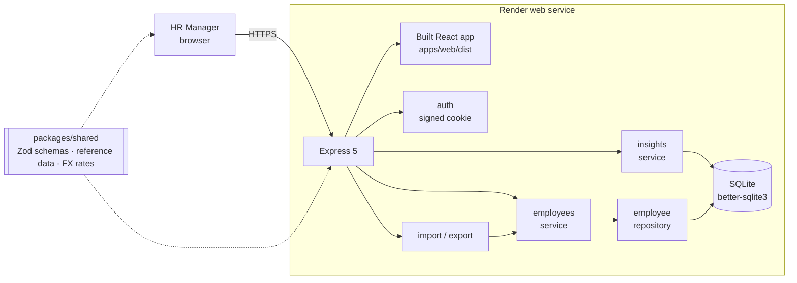
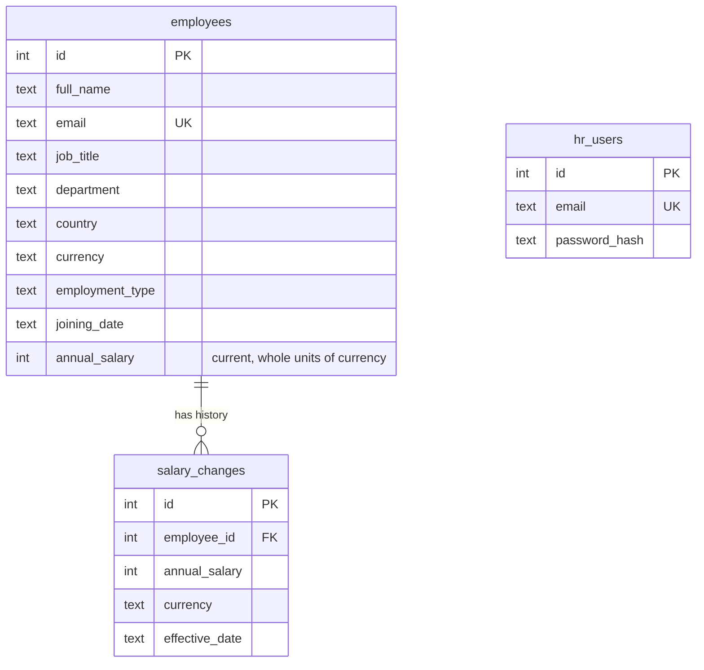

# Architecture

## Overview

One process serves both the UI and the API, so there is one URL, no CORS, and one thing to deploy.

## Layers (API)

| Layer | Responsibility | Example |
|---|---|---|
| **Routes** | HTTP only: parse/validate input with Zod, call a service, shape the response | `employees/employee-routes.js` |
| **Services** | Business rules, transactions | "a salary or currency change appends to the salary history" (`employee-service.js`) |
| **Repositories** | SQL via Drizzle | search with escaped `LIKE`, USD sort expression (`employee-repository.js`) |
| **Error handler** | Maps `ValidationError` / `NotFoundError` / `ConflictError` to 400 / 404 / 409; hides internals on 500 | `http/error-handler.js` |

Services take their dependencies as arguments (`db`, `clock`), so tests build them on an in-memory database with a fixed "today".

## Data model

- The **current salary is denormalised** onto `employees` so lists and aggregates never join history; `salary_changes` is append-only and written in the same transaction.
- Indexes: `country`, `department`, `(country, job_title)`, `full_name`, unique `email`.
- **Currency** is derived from country (one currency per country). USD figures use fixed rates in `packages/shared/src/reference-data.js`; in SQL a `CASE currency …` expression lets the database sort and sum in USD.

## Key flows

**Edit with a pay change** — `PUT /api/employees/:id` → validate with the shared schema → in one transaction: update the row; if salary or currency changed, insert a `salary_changes` row effective on the chosen date (default today).

**Import** — upload → parse xlsx/csv (headers matched by name, Excel dates and `1,250,000`-style numbers handled) → validate **every** row → if any error, return all of them (422) and write nothing → otherwise run creates/updates through the employee service in one transaction. A *dry run* executes exactly the same path and rolls back, so the preview counts are exact.

**Insights** — counts, min, max, average and USD sums are SQL aggregates; medians and histograms are computed from the salaries of one group (a few thousand integers at most) by small pure functions.

## Front end

- **Server state** with TanStack Query; any mutation invalidates employee lists, history and insights. A 401 anywhere returns the user to the login screen.
- **List state in the URL** (`?country=Germany&sortBy=annualSalary…`) — shareable and back-button friendly.
- **Same validation** as the server: forms parse with the shared Zod schema; server field errors are mapped onto the same inputs.
- The charts bundle is lazy-loaded with the insights page.

## Security

- bcrypt password hash; signed, `HttpOnly`, `SameSite=Lax` session cookie (`Secure` in production), 8-hour expiry. Same message for unknown email and wrong password.
- All employee and insight routes require a session. `SESSION_SECRET` is mandatory in production.
- Input validated at every boundary; search wildcards escaped; uploads limited to 5 MB / 20,000 rows; exported text that looks like a formula is prefixed to prevent spreadsheet injection.
